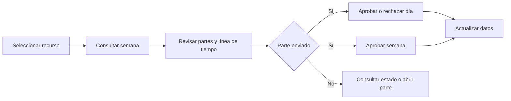

# Aprobación de Control Horario

Control PCF para Power Apps que permite a un supervisor revisar y gestionar los partes diarios y las horas registradas de sus recursos en una vista semanal.

## Vista general

```text
┌──────────────────────┬─────────────────────────────────────────────────────────────┐
│ MIS RECURSOS         │ APROBACIONES                    [Aprobar semana] [Actualizar]│
│ [ Buscar recurso… ]  │                 [‹] Semana del 10 al 16 de noviembre [›]    │
│                      │                 Zoom [−] 100 % [+]                          │
│  Ana García          ├─────────┬─────────┬─────────┬─────────┬─────────┬──────┬─────┤
│  Luis Pérez          │ Lunes   │ Martes  │Miércoles│ Jueves  │ Viernes │Sábado│Dom. │
│  Marta López         │ Enviado │Aprobado │ Enviado │Borrador │ Enviado │ ...  │ ... │
│                      │ [Rech.] │         │ [Rech.] │         │ [Rech.] │      │     │
│  Selección de        │ [Aprob.]│         │ [Aprob.]│         │ [Aprob.]│      │     │
│  recurso supervisado │   ▒▒    │   ▒     │   ▒▒    │   ▒     │   ▒▒    │      │     │
│                      │   ▒     │   ▒▒    │   ▒     │   ▒     │   ▒     │      │     │
│                      │ Línea de tiempo diaria, de 00:00 a 24:00                │     │
└──────────────────────┴─────────┴─────────┴─────────┴─────────┴─────────┴──────┴─────┘
```

El panel presenta los recursos en una lista lateral y los siete días de la semana en columnas. Cada columna muestra el estado del parte, el progreso frente al horario objetivo y las entradas de tiempo situadas según su hora de inicio y fin. El diseño se adapta al espacio asignado por el formulario y permite ampliar o reducir la línea de tiempo.

## Funcionalidades

- **Selección y búsqueda de recursos:** filtra por nombre y permite elegir el recurso que se va a revisar.
- **Navegación semanal:** muestra la semana de lunes a domingo; los controles permiten cambiar de semana y actualizar los datos.
- **Revisión diaria:** muestra el parte diario, su estado, las horas de inicio y fin, y el progreso de las horas registradas frente a la duración objetivo.
- **Detalle de actividad:** representa cada entrada en la línea de tiempo de 24 horas. Al pasar sobre una entrada se muestra su tipo, horario y cliente cuando está disponible.
- **Aprobación individual:** los partes en estado **Enviado** se pueden aprobar o rechazar desde su día. Al seleccionar el estado del parte se abre su registro en una ventana nueva.
- **Aprobación semanal:** el botón **Aprobar semana** aprueba todos los partes enviados de la semana seleccionada. Si alguna actualización falla, el panel informa de los errores parciales.
- **Idiomas:** la interfaz utiliza español, portugués (Portugal) o inglés según el idioma del usuario de Power Apps.
- **Estados visibles:** Borrador, Inactivo, Enviado, Aprobado y Rechazado.

### Flujo de uso



## Datos y configuración

El control consulta y actualiza datos mediante la Web API de Dataverse. El usuario y el rol que ejecutan el control necesitan permisos para leer los datos y actualizar el estado de los partes.

| Tabla de Dataverse | Uso |
|---|---|
| `bookableresource` | Lista de recursos activos y sus nombres. |
| `msdyn_timeentry` | Entradas de tiempo del recurso durante la semana. |
| `msdyn_workorder` | Asociación de una entrada con el nombre del cliente. |
| `sec_partediario` | Parte diario, fechas, horario objetivo y estado; se actualiza al aprobar o rechazar. |

El manifiesto del control requiere:

- Un campo enlazado (`boundField`).
- El parámetro de entrada `sec_region`: **España (1)**, **Portugal (2)** o **Latam (3)**.
- La característica Web API de Power Apps.

**Filtrado regional actual:** solo se excluyen los recursos inactivos. No se aplica un filtro por usuario en ninguna región. El nombre del usuario actual para el registro del rechazo se obtiene del contexto del control, sin consultar `systemuser`.

Los valores de estado utilizados por el control son:

| Estado | Código |
|---|---:|
| Borrador | `1` |
| Inactivo | `2` |
| Enviado | `909540001` |
| Aprobado | `909540002` |
| Rechazado | `909540003` |

## Desarrollo

Requisitos: Node.js y npm. Desde la raíz del proyecto:

```bash
npm install
npm run build
```

Para comprobar el estilo del código:

```bash
npm run lint
```

La implementación del control está en `AprobacionControlHorario/`; el manifiesto declara la región, el campo enlazado y los recursos visuales.
